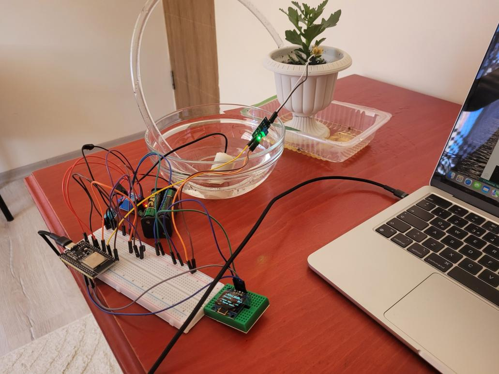
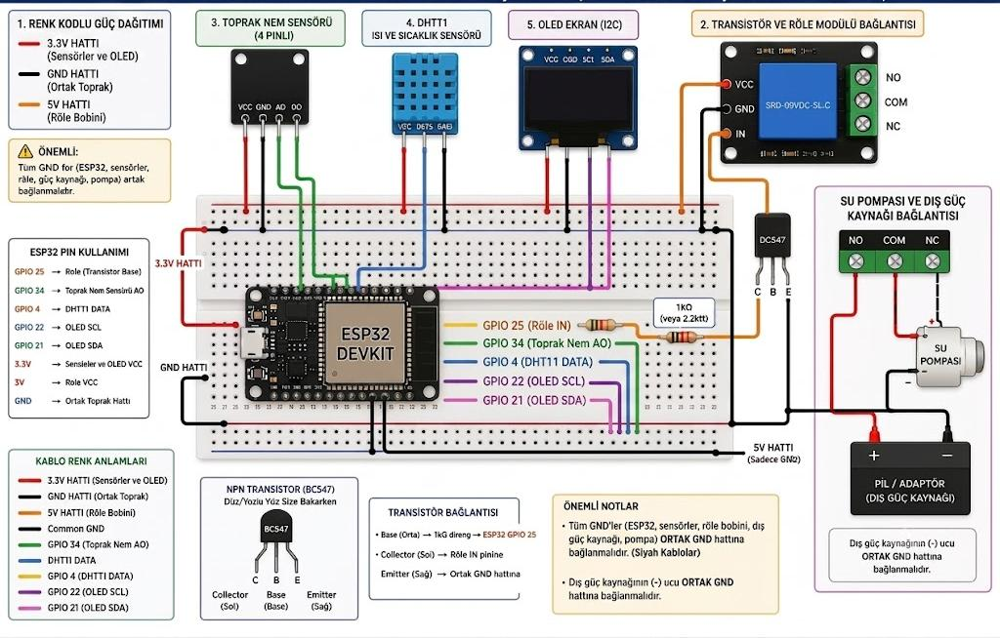
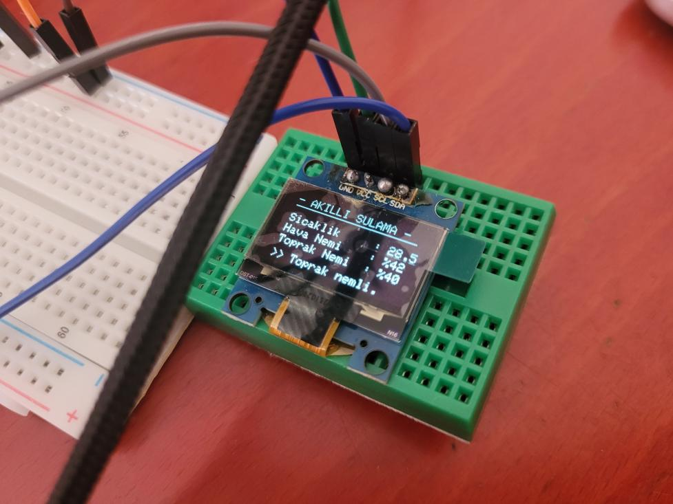

# 🌱 ESP32 Tabanlı Akıllı Bitki Takip ve Sulama Sistemi

> **T.C. Mehmet Akif Ersoy Üniversitesi** – Bucak Bilgisayar ve Bilişim Fakültesi, Yazılım Mühendisliği Bölümü
> **Gömülü Sistemler Dersi Proje Raporu**



## 📖 İçindekiler

- [Projenin Amacı ve Özeti](#-projenin-amacı-ve-özeti)
- [Faydalar ve Teknik Hedefler](#-sistemin-sağladığı-faydalar-ve-teknik-hedefler)
- [Donanım Bileşenleri](#-donanım-bileşenleri)
- [Devre Şeması ve Pin Bağlantıları](#-devre-şeması-ve-pin-bağlantıları)
- [Kurulum](#-kurulum)
- [Çalışma Mantığı](#-çalışma-mantığı)
- [Geliştirilebilirlik](#-projenin-geliştirilebilirliği-ve-esnekliği)
- [Proje Yapısı](#-proje-yapısı)

## 🎯 Projenin Amacı ve Özeti

Bu projenin temel amacı; bitkilerin ideal büyüme ortamını sürekli izlemek ve insan müdahalesine gerek kalmadan, sadece ihtiyaç duyulduğunda otomatik olarak sulanmasını sağlayan gömülü bir sistem geliştirmektir. Proje kapsamında, mikrodenetleyici tabanlı bir kontrol mekanizması kurularak hem su tasarrufu sağlanması hem de bitki sağlığının maksimum düzeyde korunması hedeflenmiştir.

## ✅ Sistemin Sağladığı Faydalar ve Teknik Hedefler

- **Su Tasarrufu ve Bitki Sağlığı:** Toprak nemini anlık olarak ölçerek bitkiyi aşırı sulamadan (kök çürümesinden) korur. Sadece toprak kuruduğunda (belirlenen kritik eşik değerinin altına düştüğünde) su pompasını devreye sokarak su israfını önler.
- **Mikroklimatik Ortam İzleme:** Sistem, sadece toprağı değil, bitkinin bulunduğu ortamın sıcaklığını ve hava nemini de eş zamanlı takip ederek bitkinin yetişme koşulları hakkında kapsamlı veri sunar.
- **Donanım Güvenliği ve Kararlılık:** Yüksek akım çeken ve endüktif yük oluşturan röle/pompa gibi bileşenlerin mikrodenetleyici pinlerine zarar vermesini engellemek için araya transistörlü bir sürücü devresi entegre edilmiştir.
- **Kullanıcı Bilgilendirmesi (Arayüz):** OLED ekran sayesinde sensör verileri ve sistemin anlık durumu (örn. *"Su Veriliyor"*, *"Toprak Nemli"*) kullanıcıya görsel olarak raporlanır.

## 🔧 Donanım Bileşenleri

| Bileşen | Açıklama |
|---|---|
| **ESP32** | Kontrolcü (yüksek işlem gücü, dahili ADC ve Wi-Fi) |
| **0.96" SSD1306 OLED** | Görsel arayüz (I2C) |
| **DHT11** | Ortam sıcaklık ve nem sensörü |
| **Toprak Nem Sensörü** | 4 pinli higrometre |
| **5V Röle Modülü** | Pompa anahtarlama |
| **BC547 NPN Transistör** | Röle sürücüsü |
| **1kΩ Direnç** | Transistör baz koruma direnci |
| **5V Mini Su Pompası** | Sulama |

## 🔌 Devre Şeması ve Pin Bağlantıları



*Şekil 1: ESP32 Akıllı Sulama Sistemi ve renk kodlu devre bağlantı şeması.*

| ESP32 Pini | Bağlantı |
|---|---|
| GPIO 25 | Röle IN (BC547 transistör üzerinden, 1kΩ baz direnci ile) |
| GPIO 34 | Toprak Nem Sensörü AO |
| GPIO 14 | DHT11 DATA |
| GPIO 21 | OLED SDA |
| GPIO 22 | OLED SCL |
| 3.3V | Sensörler ve OLED VCC |
| GND | Ortak toprak hattı |

> **Not:** Kodda DHT11 veri pini `GPIO 14` olarak tanımlıdır (devre şemasında GPIO 4 görünmektedir). Kendi bağlantınıza göre `DHTPIN` değerini güncelleyin.

> ⚠️ **Önemli:** Tüm GND'ler (ESP32, sensörler, röle bobini, dış güç kaynağı, pompa) **ortak GND** hattına bağlanmalıdır. Dış güç kaynağının (–) ucu da ortak GND hattına bağlanmalıdır.

## 🚀 Kurulum

1. [Arduino IDE](https://www.arduino.cc/en/software)'ye ESP32 kart desteğini ekleyin.
2. **Kütüphane Yöneticisi** üzerinden aşağıdaki kütüphaneleri kurun:
   - `Adafruit GFX Library`
   - `Adafruit SSD1306`
   - `DHT sensor library` (Adafruit)
3. [`src/akilli_sulama/akilli_sulama.ino`](src/akilli_sulama/akilli_sulama.ino) dosyasını açın.
4. Kart olarak **ESP32 Dev Module** seçip kodu yükleyin.
5. Seri monitörü `115200` baud hızında açabilirsiniz.

## ⚙️ Çalışma Mantığı

1. DHT11'den sıcaklık ve hava nemi okunur; hatalı okumada son geçerli değer korunur.
2. Toprak nem sensörünün ham ADC değeri, kalibrasyon değerlerine (`KURU_DEGER = 4000`, `ISLAK_DEGER = 1500`) göre **%0–100** aralığına dönüştürülür ve 10'un katlarına yuvarlanır.
3. Değerler OLED ekrana yazdırılır.
4. Toprak nemi **%30 veya altındaysa** röle tetiklenir ve pompa çalışır (`>> SU VERILIYOR...`); değilse pompa kapalı kalır (`>> Toprak nemli.`).
5. Döngü her **2 saniyede** bir tekrarlanır.



*Şekil 3: OLED ekran üzerindeki kullanıcı arayüzü ve anlık sensör verileri.*

## 📈 Projenin Geliştirilebilirliği ve Esnekliği

- **Bitkiye Özel Parametrik Yazılım:** Sulama eşik değeri (örn. %30) her bitkinin su ihtiyacına göre kolayca değiştirilebilir. Örneğin çok su seven bir eğrelti otu için %60, kaktüs veya sukulent için %15 yapılabilir.
- **Nesnelerin İnterneti (IoT) ve Uzaktan Erişim:** ESP32'nin dahili Wi-Fi modülü ile mobil uygulama veya yerel web sunucusu entegre edilerek uzaktan veri takibi ve manuel müdahale sağlanabilir.
- **Veri Analitiği:** Sıcaklık, hava nemi ve toprak nemi verileri zaman damgalı olarak buluta kaydedilip bitkinin mevsimsel su tüketim grafikleri çıkarılabilir.

## 📁 Proje Yapısı

```
akilli-sulama-sistemi/
├── README.md
├── src/
│   └── akilli_sulama/
│       └── akilli_sulama.ino   # ESP32 kaynak kodu
├── images/
│   ├── devre-semasi.jpg        # Devre bağlantı şeması
│   ├── prototip.jpg            # Fiziksel prototip
│   └── oled-arayuz.jpg         # OLED arayüz
└── docs/
    └── proje-raporu.pdf        # Orijinal proje raporu
```
